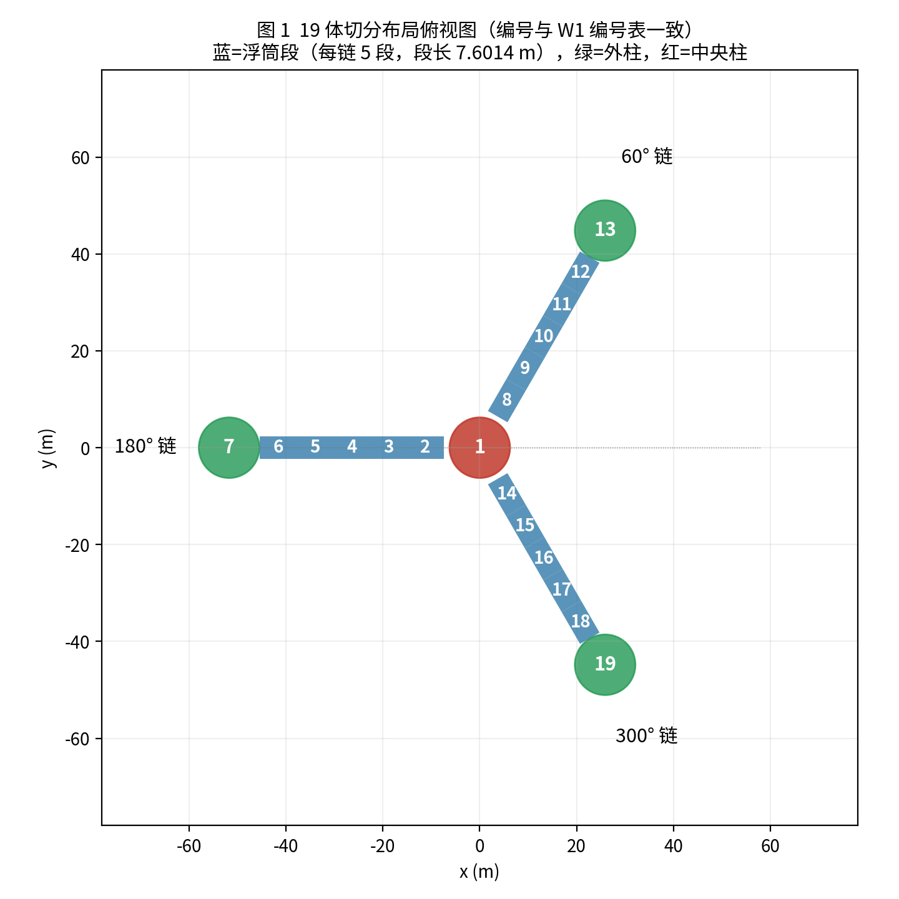
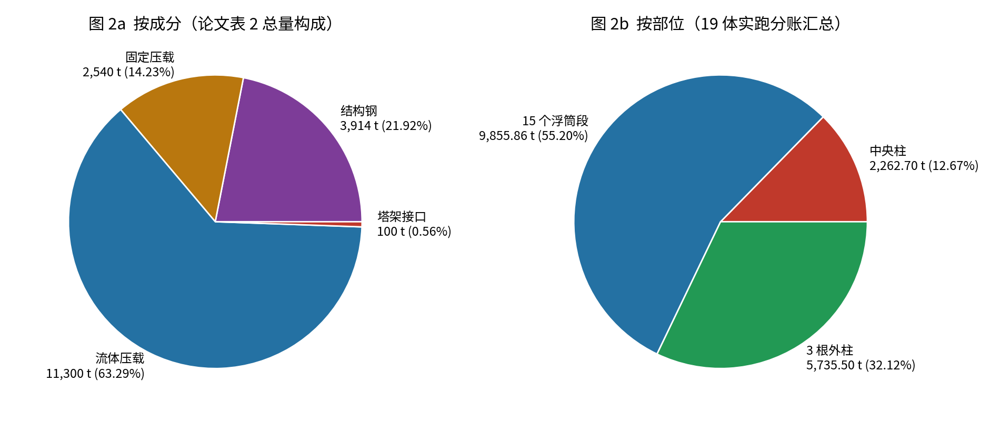
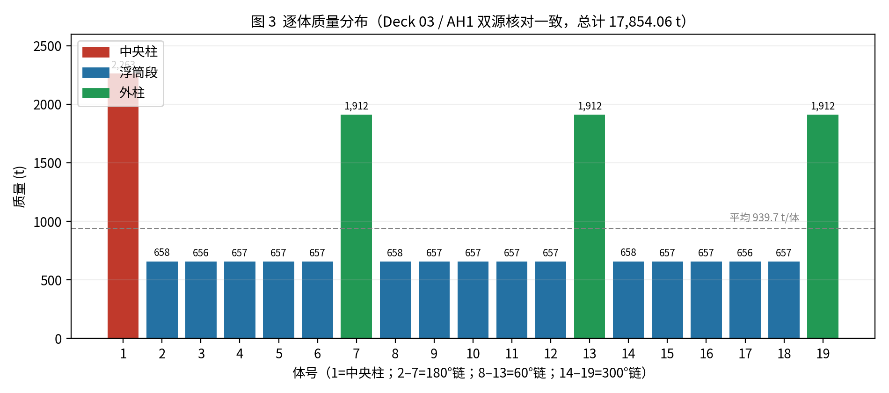
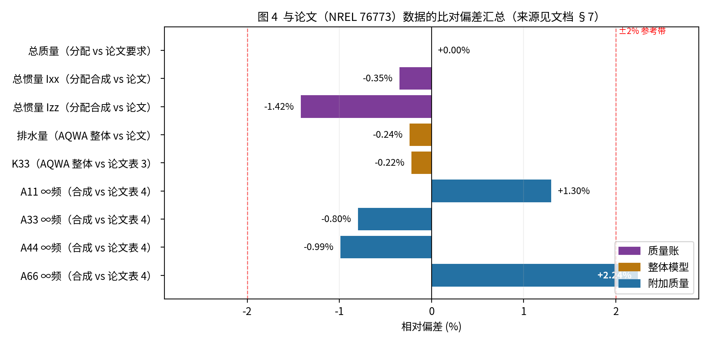

# 19 体模型各物理性质的分配方法与论文数据比对

- 日期：2026-11-16
- 对象：IEA 15 MW VolturnUS-S 浮式平台的 19 体 AQWA 模型（2026-11-11 实跑口径）
- 论文基准：NREL/TP-5000-76773（平台定义，下称"论文"；表号均指该报告）
- 数据出处：逐体质量/重心/惯量以 `futi_19body.dat`（Deck 01/03/04）与 AH1 双源核对一致为准；合成值引 `19body-synthesis-verification.md` 与 `synthesis_results.json`；无穷频率附加质量引 GATE-B 复核记录（`gate-b-results.json`）；整体单体比对引 GATE 1A 验证结论

## 0. 先分清三类性质：不是所有性质都靠"分配"

19 体模型的性质按来源分三类，本文逐类说明：

| 类别 | 性质 | 怎么定的 |
|---|---|---|
| **人工分配**（填卡输入） | 质量、重心、惯量 | 论文只给整体口径，必须由建模者拆到 19 体后填入 dat（Deck 01/03/04 的 PMAS 点质量）。这是唯一真正意义上的"分配"，§2–§4 |
| **求解器按几何算出**（无需分配） | 排水量/浮力、静水刚度、附加质量、辐射阻尼、波浪激励力 | AQWA 按各体湿表面几何与相对位置自动算出，含全部体间水动力耦合。建模者能做的只有事后把逐体结果**合成**回整体与论文/整体模型比对验证，§5–§7 |
| **尚未分配** | 粘性阻尼（论文表 5） | 势流方法算不出，论文给的是整体口径，拆分口径待拍板（W7 前置），§8 |

一个总原则（路线红线 R9）：**禁止按体积/排水量比例分配质量**。原因是压载占总质量 77.5% 且布置集中（见 §2.1），按体积分配会把重心拉错约 8 m 量级。实测反例：外柱按排水量比例应分得约 2,267 t，实际 1,911.8 t（−15.7%）；浮筒第 2 段按比例应约 574 t，实际 656.45 t（+14.4%）。

## 1. 切分几何（分配的空间框架）

每根浮筒沿径向均分 5 段的计算：

- 浮筒径向跨度：自中央柱外缘 r = 7.409 m 至外柱内缘 r = 45.416 m，全长 45.416 − 7.409 = 38.007 m
- 段长 = 38.007 / 5 = **7.6014 m**；段界 r = 7.409 / 15.010 / 22.612 / 30.213 / 37.815 / 45.416 m
- 段几何中心 r = 11.210 / 18.811 / 26.412 / 34.014 / 41.615 m
- 四根立柱各为 1 体；每链 = 5 段 + 1 外柱 = 6 体，三链 + 中央柱 = **19 体**；每链内界面 6 道（中央柱根、段间 4、外柱根），共 **18 道可测界面**
- 切分只改面元归属、不重划网格：总面元 6,943、DIFF 面元 5,454 与整体模型逐个一致（Deck 级核查，2026-11-16）；切面为干截面，不补面元

## 2. 质量：总量来自论文，按构件布置拆到体

### 2.1 第一层：成分总量（论文表 2 / §2.1，唯一出处）

| 成分 | 质量 (t) | 占比 | 论文给定的布置 |
|---|---|---|---|
| 结构钢 | 3,914 | 21.92% | 全结构（立柱、浮筒、中央柱） |
| 固定压载（铁矿石混凝土） | 2,540 | 14.23% | 三根外柱柱底，三等分 |
| 流体压载（海水） | 11,300 | 63.29% | 三根浮筒的大部分 + 外柱柱底一部分 |
| 塔架接口点质量 | 100 | 0.56% | 中央柱顶 |
| **合计** | **17,854** | 100% | 在站总质量 |

### 2.2 第二层：构件 → 体型的分配规则

| 体型 | 分到的成分 |
|---|---|
| 中央柱（体 1） | 中央柱钢 + 塔架接口 100 t |
| 浮筒段（15 体） | 该段钢 + 该段内的流体压载份额（三链对称，同链各段按灌注长度均分） |
| 外柱（体 7/13/19） | 外柱钢 + 固定压载份额 + 柱底流体压载份额 |

其中只有两笔能由论文规则**精确计算**：

- 固定压载/柱 = 2,540 / 3 = **846.67 t**
- 塔架接口 = **100 t**，全量在中央柱

### 2.3 计算过程的诚实边界

逐体质量的原始估算过程（W2 原件）已遗失、不可复原，本文不虚构该过程。能确证的是：分配结果（§2.4 的账）真实存在于实跑模型中（dat 与 AH1 双源一致），且满足全部可检验的约束——成分总量守恒、布置规则、三链对称、三笔账合成对论文（§2.5、§3、§4）。以下两笔是由账面反推的**推算值**（非原始记录）：中央柱钢 = 2,262.70 − 100 = 2,162.7 t；每根外柱"钢 + 柱底流体份额" = 1,911.80 − 846.67 = 1,065.1 t。

还有一条可由总量算出的硬约束，说明流体压载不可能全在浮筒段内：15 段总质量只有 9,855.86 t < 流体压载总量 11,300 t，故至少 11,300 − 9,855.86 = **1,444.14 t 流体压载必在段外**（外柱柱底）；计入段内钢后实际段外份额更大。这也是"单体内钢/压载精确分拆不可复原"的算术证明：未知量（18 个体的钢与流体份额）多于方程（钢、流体各一条总量约束）。

### 2.4 第三层：逐体分账结果

| 体 | 质量 (t) | 体 | 质量 (t) | 体 | 质量 (t) |
|---|---|---|---|---|---|
| 1 中央柱 | 2,262.70 | 8 | 657.60 | 14 | 658.48 |
| 2 | 658.33 | 9 | 656.63 | 15 | 656.75 |
| 3 | 656.45 | 10 | 656.73 | 16 | 656.72 |
| 4 | 656.73 | 11 | 656.90 | 17 | 656.43 |
| 5 | 656.92 | 12 | 657.06 | 18 | 657.25 |
| 6 | 656.88 | 13 外柱 | 1,911.80 | 19 外柱 | 1,911.90 |
| 7 外柱 | 1,911.80 | | | | |

分布特征：浮筒段合计 9,855.86 t（55.20%）、外柱合计 5,735.50 t（32.12%）、中央柱 2,262.70 t（12.67%）；三链质量和 5,197.11 / 5,196.72 / 5,197.53 t，极差 0.016%（120° 对称在质量上成立）；15 段极差 2.05 t（0.31%），与"均分 + 均匀灌注"口径一致。

### 2.5 验证计算（账一：总质量）

$$M = \sum_{i=1}^{19} m_i = 17{,}854.06\ \text{t}$$

对论文要求 17,854 t 的偏差为 **+0.0003%**。

## 3. 重心：随质量账逐体给定，合成验证

每体在 AQWA 中是一个点质量，其重心位置即该体质量的放置点（dat 中为 PMAS 节点坐标）。放置规则与实测值：

| 体型 | 重心位置 | 说明 |
|---|---|---|
| 浮筒段 | 径向 11.194 / 18.803 / 26.401 / 34.003 / 41.606 m；z ≈ −16.50 m | 径向比段几何中心内偏 0.008–0.016 m（质量分布所致）；z 在浮筒中心高（浮筒 z −20…−13），与"压载灌于筒内、沿筒均匀"一致 |
| 外柱 | 径向 50.998 m；z = −13.322 m | 径向比柱轴（51.75 m）内偏 0.75 m；z 高于浮筒段，因柱钢沿全高分布、压载只在柱底，两者平衡点在此 |
| 中央柱 | (0.001, 0.003, −12.247) m | 三类中最高：柱体向上出水至 +15 m，且 100 t 接口质量在柱顶 |

验证计算（账二：总重心），质量加权平均：

$$\mathbf{r}_G = \frac{\sum_i m_i \mathbf{r}_i}{\sum_i m_i} = (0.0005,\ 0.0002,\ -14.940)\ \text{m}$$

对论文整体重心 (0, 0, −14.94) m：x/y 偏差 < 1 mm（由三链对称相消），z 偏差 < 0.001 m。

## 4. 惯量：逐体全张量给定，平行轴合成验证

每体惯量以绕其自身重心的 6 分量张量（Ixx, Iyy, Izz, Ixy, Ixz, Iyz）填入 dat Deck 04。典型值：

| 体型 | Ixx | Iyy | Izz | 特征 |
|---|---|---|---|---|
| 中央柱 | 2.401×10⁸ | 2.401×10⁸ | 6.817×10⁷ | 绕 z 对称 |
| 浮筒段（180° 链） | ≈1.27×10⁷ | ≈6.37×10⁶ | ≈1.27×10⁷ | 盒段形态：沿筒轴（y 向局部）惯量最小 |
| 浮筒段（60°/300° 链） | ≈7.96×10⁶ | ≈1.11×10⁷ | ≈1.27×10⁷ | Ixy = ±2.75×10⁶，符号随链方位翻转（坐标旋转的必然结果） |
| 外柱 | ≈1.88×10⁸ | ≈1.88×10⁸ | ≈5.07×10⁷ | 与中央柱同量级（柱体 + 柱底压载） |

（单位 kg·m²。60°/300° 段的 Ixx/Iyy 与 180° 段不同不是分配差异，而是同一盒段在全局坐标系旋转 120°/240° 后的张量变换结果。）

验证计算（账三：总惯量），逐体惯量用平行轴定理搬到总重心后求和：

$$\mathbf{I}_G = \sum_i \left[ \mathbf{I}_i + m_i \left( (\mathbf{d}_i \cdot \mathbf{d}_i) \mathbf{E} - \mathbf{d}_i \mathbf{d}_i^{T} \right) \right], \quad \mathbf{d}_i = \mathbf{r}_i - \mathbf{r}_G$$

| 量 | 合成值 | 论文值 | 偏差 | 判据 |
|---|---|---|---|---|
| Ixx | 1.2466×10¹⁰ | 1.251×10¹⁰ | −0.35% | <2% ✓ |
| Iyy | 1.2466×10¹⁰ | 1.251×10¹⁰ | −0.35% | <2% ✓ |
| Izz | 2.3335×10¹⁰ | 2.367×10¹⁰ | −1.42% | <2% ✓ |

注：三笔账验证的是**分配结果的合成总量**与论文一致，不反证单体内部的钢/压载构成（见 §2.3）。

## 5. 静水刚度：不分配，由湿表面几何决定，合成后验证

静水刚度没有任何人工分配：AQWA 对每个体按其湿表面（DIFF 面元）积分，得到绕该体重心的 6×6 静水刚度矩阵。其物理构成决定了分布形态：

- 垂荡刚度 K33 = ρg·A_wp，只来自**水线面面积**。浮筒段全浸没（水线面为 0），对 K33 的贡献≈0；全部水线面在四根立柱上。由合成 K33 反算：A_wp = 4.4603×10⁶ / (1025 × 9.81) ≈ **443.6 m²**
- 横摇/纵摇刚度 K44/K55 由水线面惯性矩与浮心/重心相对位置决定，各体均有贡献，且必须变换到同一参考点才能相加

合成计算（`verify_19body.py` 实现）：把每个体的刚度矩阵按刚体运动学变换（力臂 d_i 引起的力-力矩耦合项一并计入）搬到总重心 (0, 0, −14.94)，再逐元素求和：

| 量 | 19 体合成 | 整体单体模型 | 偏差 |
|---|---|---|---|
| K33 | 4.4603×10⁶ N/m | 4.460×10⁶ | +0.01% |
| K44（总刚度，绕总重心） | 5.196×10⁹ N·m/rad | 5.229×10⁹ | −0.64% |
| K55（总刚度，绕总重心） | 5.195×10⁹ N·m/rad | 5.229×10⁹ | −0.64% |

与论文表 3 的比对在整体模型层完成（GATE 1A）：论文 K33 = 4.470×10⁶，整体 AQWA = 4.460×10⁶，偏差 −0.22%。注意口径：表 3 的刚度参考点与 AQWA 输出的参考点不同，GATE 1A 已做分解对齐（绕重心总刚度 5.229×10⁹ 中水动力分量与表 3 比对，最大偏差 0.51%），引用时不得跨参考点直接比。

子体单独的静水量不成立（湿表面不闭合，如外柱单体质量/排水量差约 −27%），只有合成值有物理意义——这是"分配—合成"口径在刚度上的具体含义。

## 6. 附加质量与辐射阻尼：不分配，求解器含耦合算出

势流部分同样没有人工分配。AQWA 对 19 体联立求解绕射/辐射问题，输出的是完整的耦合矩阵族：附加质量与辐射阻尼各 **361 个 6×6 块（19×19，含全部体间耦合）× 47 个频点**。任何一体的附加质量都不是它单独的性质——例如浮筒段的运动会通过流场改变相邻段的受力，这正是耦合块非零的原因。因此"合成"也不是只加对角块，而是把 361 块全部变换到总重心再求和。

合成结果与比对：

| 量 | 19 体合成 | 比对对象 | 偏差 |
|---|---|---|---|
| A33（ω = 2.10 rad/s） | 2.4257×10⁷ kg | 整体单体同频值 | −0.2% |
| A11（ω = 2.10） | 8.2353×10⁶ kg | —（合成值存档于 `synthesis_results.json`） | — |

无穷频率附加质量 A∞ 的处理有一个插曲：本次 AQWA 运行 LHFR 关闭，AH1 不含 A∞；W6 中 BEMIO 的 radiationIRF 由辐射阻尼积分重算了 A∞。将 19 体 A∞ 按刚体合成到静水面原点后与论文表 4 比对：

| 量 | 合成值 | 论文表 4 | 偏差 |
|---|---|---|---|
| A11 | 9.766×10⁶ | 9.640×10⁶ | +1.30% |
| A33 | 2.460×10⁷ | 2.480×10⁷ | −0.80% |
| A44 | 1.1485×10¹⁰ | 1.160×10¹⁰ | −0.99% |
| A55 | 1.1485×10¹⁰ | 1.160×10¹⁰ | −0.99% |
| A66 | 2.0549×10¹⁰ | 2.010×10¹⁰ | +2.24% |
| A15 | −1.0135×10⁸ | −1.010×10⁸ | +0.35% |

（单位：平动 kg、转动 kg·m²、耦合 kg·m。参考点为静水面原点，与表 4 口径一致后才可比。）

由合成后的质量、刚度、附加质量解出的固有频率（计算方式：平动以垂荡为例 ω = √[K33 / (M + A33(ω))]，转动自由度相应地用惯量与转动附加质量；因 A 随频率变化，取自洽频点迭代）：

| 量 | 19 体合成 | 整体单体 | 论文推导值（状态 A） |
|---|---|---|---|
| 垂荡 | 0.3143 rad/s | 0.315 | 0.316 |
| 纵摇/横摇 | 0.4622 rad/s | 0.466 | 0.474 |

注意：论文表 11 的纵摇 0.036 Hz 是含系泊与风机的**全系统**口径（状态 B），与上表纯浮体口径（状态 A）不可混比。

## 7. 波浪激励力：逐体由求解器算出，合成需相位修正

每体的激励力（FORCERAO）是复数，参考点在各自重心。合成到整体时不能直接相加，必须先做相位修正（把参考点统一到合成重心）：经符号裁决（以整体单体 LIS 为外部基准全谱比对），计划书公式 corr+（exp(+ik·r)，k 为波数、r 为体心相对合成重心的位置）正确，corr− 排除。合成验证：全谱（25 浪向 × 47 频点 × 6 自由度）复数误差中位 **0.102%**、相位误差中位 **0.004°**。长波自洽检查：ω = 0.02 rad/s 时合成 |Fz| = 4.4426×10⁶ N/m ≈ ρg·A_wp（与 §5 由 K33 反算的水线面一致），三个浪向（0°/90°/180°）一致。

（对比 §0 的分类：质量、刚度、附加质量、激励力中，只有质量类是"分配"的；其余的"合成"是验证手段，不是建模输入。RAO 不是可合成量——它是装配后运动方程的解，须在 WEC-Sim 刚接装配后求得，属 GATE-C。）

## 8. 粘性阻尼（论文表 5）：唯一尚未分配的性质

势流方法（AQWA/BEMIO）只产生辐射阻尼，算不出粘性阻尼。论文表 5 是 CFD（OpenFOAM）给出的**整体**二次阻尼矩阵（力 ∝ |v|·v），参考点在静水面塔架轴线（不是重心）：

| 项 | 值 | 项 | 值 |
|---|---|---|---|
| Surge 对角 | 9.225×10⁵ | Roll 对角 | 1.676×10¹⁰ |
| Sway 对角 | 9.225×10⁵（报告的对称取值） | Pitch 对角 | 1.676×10¹⁰ |
| Heave 对角 | 2.296×10⁶ | Yaw 对角 | 4.798×10¹⁰ |
| Surge–Pitch 交叉 | −8.918×10⁶ | Sway–Roll 交叉 | +8.918×10⁶ |

（平动对角单位 N·s²/m²，转动对角 N·m·s²，交叉 N·s²/m。表 5 只基于 surge、heave、roll、yaw 四个单自由度 CFD 工况。）

它在 19 体模型里的分配**尚未执行**：WEC-Sim 中阻尼须逐体施加，而表 5 是整体量，拆分必须满足"刚接装配等效回整体后与表 5 对上（含交叉项）"。三个候选口径已备案待拍板——A：平动对角按迎流投影面积拆、转动/交叉由刚体输运产生；B：表 5 整体不拆、挂在装配整体上；C：逐体 Morison Cd 标定。此项是 W7 的入口决策，在其拍板前本文不预设分配结果。

## 9. 与论文比对总表

| 量 | 论文（NREL 76773） | 整体单体 AQWA（GATE 1A） | 19 体分配/合成 | 关键偏差 |
|---|---|---|---|---|
| 总质量 | 17,854 t（表 2） | 17,854 t（填卡） | 17,854.06 t | +0.0003%（对论文要求） |
| 总重心 z | −14.94 m | −14.94 m | −14.940 m | ≈0 |
| 总惯量 Ixx / Izz | 1.251 / 2.367×10¹⁰ | —（同源输入） | 1.2466 / 2.3335×10¹⁰ | −0.35% / −1.42% |
| 排水量 | 20,206 m³ | 20,158 m³ | 20,157.9 m³ | 整体对论文 −0.24%；合成对整体 −0.001% |
| K33 | 4.470×10⁶（表 3） | 4.460×10⁶ | 4.4603×10⁶ | 整体对论文 −0.22%；合成对整体 +0.01% |
| K44/K55 总刚度 | 表 3（分解对齐后比对） | 5.229×10⁹ | 5.196 / 5.195×10⁹ | 合成对整体 −0.64%；GATE 1A 水动力分量对论文 ≤0.51% |
| A∞（表 4 六项） | 见 §6 表 | — | 见 §6 表 | −0.99% … +2.24% |
| 垂荡固有频率 | 0.316 rad/s（推导，状态 A） | 0.315 | 0.3143 | 合成对整体 −0.2% |
| 纵摇固有频率 | 0.474 rad/s（推导，状态 A） | 0.466 | 0.4622 | 合成对整体 −0.8% |

## 10. 总览：每个性质的"分配"到底做了什么

| 性质 | 方式 | 数据/规则来源 | 验证 |
|---|---|---|---|
| 质量 | **人工分配**：成分总量 → 布置规则 → 逐体填卡 | 论文表 2/§2.1 + 本项目布置规则 | 总质量账 +0.0003%；dat↔AH1 双源一致 |
| 重心 | 随质量账逐体给定 | 各体质量分布的平衡点 | 加权合成 (0.0005, 0.0002, −14.940) 对论文 ≈0 |
| 惯量 | 逐体全张量填卡 | 各体质量分布 | 平行轴合成对论文 −0.35%/−1.42%（<2%） |
| 排水量/浮力 | 求解器按湿几何算 | 网格（与整体同一底稿） | 合成对整体 −0.001% |
| 静水刚度 | 求解器按湿几何算 | 网格 | 合成 K33 +0.01%、K44/K55 −0.64%（对整体） |
| 附加质量/辐射阻尼 | 求解器耦合求解（361 块） | 网格 + 相对位置 | A33@2.10 −0.2%（对整体）；A∞ 对论文表 4 ≤2.24% |
| 激励力 | 求解器逐体算，合成需 corr+ 相位修正 | 网格 | 全谱对整体基准：复数中位 0.102%、相位中位 0.004° |
| 粘性阻尼 | **未分配** | 论文表 5（整体口径） | 待 W7 拍板后在 GATE-C 验证 |

**一句话总结**：真正被"分配"的只有质量类三项（质量、重心、惯量），其方法是"论文总量 + 构件布置规则 → 逐体点质量"，并用三笔账合成对论文验证闭合；其余水动力性质由求解器按同一套几何自动产生、只做合成验证；粘性阻尼是唯一还悬着的分配问题。
